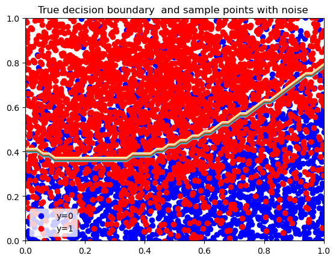
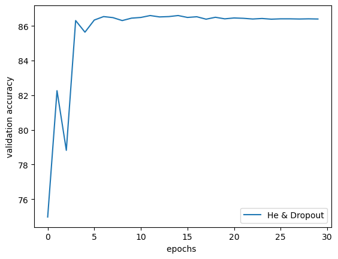
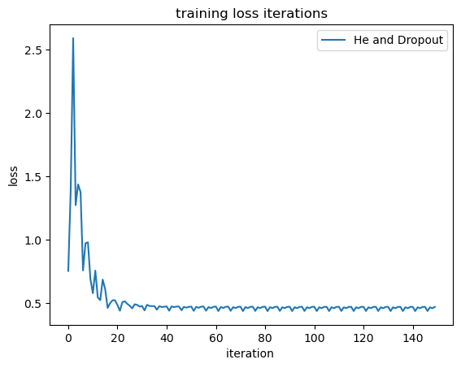

## The question

A network can fail before it starts if its weights are initialised badly, and overfit after it starts if nothing holds it back. This project trains a ReLU network on a **custom, deliberately noisy dataset** with **He initialisation** and a chosen **dropout** rate.

## What is inside

- **He weight initialisation**: a model sometimes does not function properly when its weights are not initialised suitably for training
- **Dropout**: a method to prevent overfitting
- **ReLU activation**: transforms the summed weighted input of a node into its activation

## Results

The data has a known true decision boundary with label noise around it, so a perfect score is impossible by construction. Validation accuracy settles at about **86%** within a few epochs and holds there (read from the plot below).

<table>
<tr><td width="33%" valign="top"><br><sub>The custom dataset: true decision boundary and noisy samples</sub></td><td width="33%" valign="top"><br><sub>Validation accuracy per epoch</sub></td><td width="33%" valign="top"><br><sub>Training loss per iteration</sub></td></tr>
</table>

## Run it

1. Download `spec-file.txt`.
2. Follow the instructions in `Conda_Virtual_Env.txt`:

```bash
# a new environment from the spec file
conda create --name myenv --file spec-file.txt
# or install the listed packages into an existing environment
conda install --name myenv --file spec-file.txt
```
The full set of environment commands is in [`Conda_Virtual_Env.txt`](Conda_Virtual_Env.txt).

Then open [`Weight_Init_&_Dropout_with_Relu.ipynb`](Weight_Init_%26_Dropout_with_Relu.ipynb).

## Built with

`Python` · `PyTorch` · `Matplotlib` · `Torchvision`

<br>

<p align="center"><sub>Part of the work of <a href="https://github.com/johnnyk1090">John Konteas</a> · end-to-end data science</sub></p>
